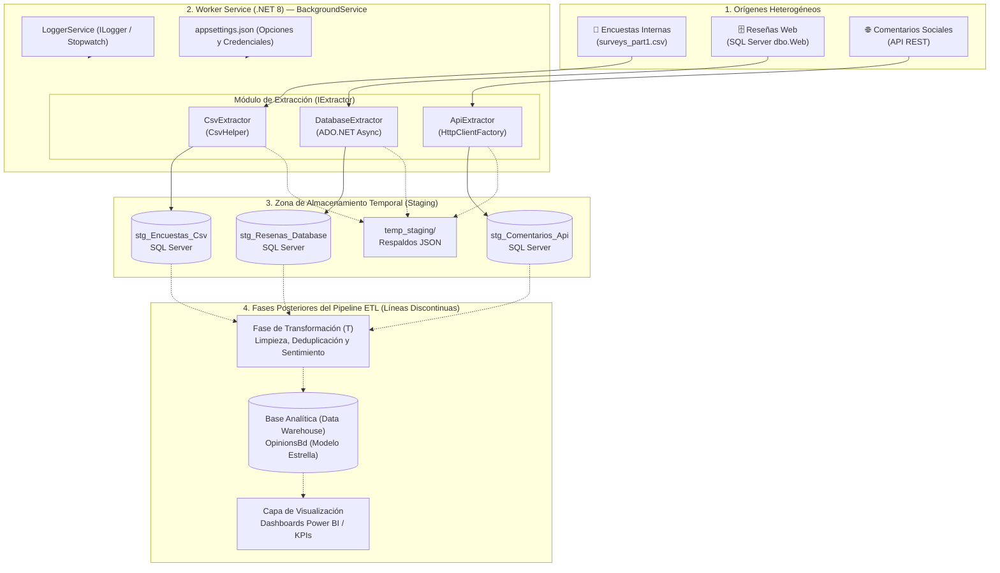

# Diagrama de Arquitectura — Sistema de Análisis de Opiniones de Clientes

**Estudiante:** Wilmer José Torres Andeliz  
**Asignatura:** Electiva I — Prof. Francis Ramírez  
**Institución:** Instituto Tecnológico de Las Américas (ITLA)  
**Fecha:** Noviembre de 2026  

---

## 🏛️ Diagrama Conceptual del Flujo de Extracción

### Componentes de la Arquitectura
* **Fuentes de datos:** Tres orígenes con contratos distintos: archivo plano estructurado (CSV), tabla relacional en SQL Server (ADO.NET) y servicio HTTP (API REST).
* **Worker Service (.NET 8):** Servicio en segundo plano (`BackgroundService`) con Inyección de Dependencias, tareas asíncronas y ejecución en paralelo (`Task.WhenAll`).
* **Zona de Staging:** Almacenamiento intermedio en tablas `stg_*` de SQL Server y volcados JSON para desacoplar la extracción de las fases de transformación.
* **Fases Posteriores:** La transformación y carga al modelo dimensional (estrella) se nutren exclusivamente de la zona de staging.
